# O-AT

**Open Audio Tools**: open source audio plugins and applications written in Rust, for
Windows and Linux (x64). Releases and the [project site](https://baalintnagy.github.io/o-at/)
offer both.

| Tool | Purpose |
| --- | --- |
| [O-NEC](#o-nec) | Voice cleanup: noise suppression, echo cancellation, voice gate and speech leveler. |
| [O-NR](#o-nr) | Noise reduction for any material, from a learned noise profile or a tracked noise floor. |
| [O-AUD-TX and O-AUD-RX](#o-aud-tx-and-o-aud-rx) | Route audio between hosts, applications and devices through named buses. |
| [O-AUD-A](#o-aud-a) | Audio analyzer: spectrum, sonogram, stereo imager, oscilloscope, loudness meter and 3D views. |

The tools are listed under the vendor `o-at` in plugin hosts. O-NEC, O-AUD-TX and
O-AUD-RX replace the earlier ONEC, AUD-TX and AUD-RX plugins. Their plugin IDs are new
(CLAP `o-at.o-nec`, `o-at.o-aud-tx`, `o-at.o-aud-rx`), so sessions saved with the earlier
plugins do not load them; replace the earlier plugins in those sessions.

## O-NEC

**Open Noise and Echo Cancelation** is a VST3 and CLAP voice cleanup plugin written in
Rust. It does what the noise suppression and echo cancellation built into voice chat
applications do, as a plugin you can put on any microphone chain, with adjustable
parameters and detailed visual feedback.


### What it does

| Stage | Purpose |
| --- | --- |
| Input gain and high-pass | Level trim and rumble removal (2nd-order Butterworth, 20–400 Hz). |
| Echo canceller | Learns the loudspeaker-to-microphone echo path from the sidechain and subtracts it. |
| Residual echo suppressor | Removes echo left by the linear canceller (non-linearities, tail, path changes). |
| Noise suppression | Removes background noise while keeping speech, with a choice of two neural models: RNNoise or DeepFilterNet3. |
| Voice gate | Opens on detected speech or above a level, like automatic or manual input sensitivity. |
| Speech leveler | Optional. Raises whispering or distant talk and lowers shouting towards a target level, measured only while someone speaks, and limits the peaks of sudden shouts. |
| Output gain | Final level trim. |

The editor shows:

- A spectrum analyzer with input, output and echo reference spectra. The pink area
  between input and output is what O-NEC removes. Hover for per-frequency readouts.
- A draggable high-pass filter handle with its response curve (double-click toggles it).
- A 4-second activity timeline of input and output levels, voice probability, gate
  state, echo reference activity and the speech leveler's gain, with a draggable gate
  threshold.
- Removed noise, voice probability, echo cancellation (ERLE), gate attenuation, speech
  level, leveler gain and peak limiting meters; echo canceller state (waiting, learning, locked, double talk); peak meters.
- **Listen removed** solos what the chain takes away, to tune settings without
  damaging speech.

The noise panel's **RNNoise / DeepFilter** switch selects the noise model. A line below
its meters shows the model's state, including when RNNoise fills in for DeepFilterNet
while it loads or during CPU overload.

Knobs: drag vertically, hold Shift for fine adjustment, use the mouse wheel, and
double-click to reset.

### Noise models

| | RNNoise | DeepFilterNet3 |
| --- | --- | --- |
| Designed for | Steady noise: fans, hum, traffic | Also non-stationary noise, such as keyboards |
| Stage delay | 10 ms | 30 ms plus 20–30 ms of scheduling slack |
| Total latency at 48 kHz | 32 ms | 72 ms (buffers up to 480 samples), 82 ms (up to 960) |
| CPU | Lowest | About 0.6 ms per 10 ms frame, on its own thread |

RNNoise is the default. Select DeepFilterNet for the strongest suppression when the extra
delay is acceptable. Switching models changes the latency reported to the host.

DeepFilterNet's inference allocates memory, so it cannot run on the audio thread. It runs
on a worker thread, and its results are used a fixed number of frames later: one more
than a single host buffer can hold, which is the scheduling slack above. If the computer
cannot keep up, RNNoise's time-aligned output fills in for the missing frames. RNNoise also
keeps running in DeepFilterNet mode to provide the voice probability for the gate.

### Echo cancellation needs a reference

A voice chat application cancels echo because it knows what it plays to your
speakers. A plugin only knows what its host gives it, so O-NEC takes the far-end
signal (what your speakers play) on its **Echo Reference** sidechain input. Without a
reference, the echo stages stay idle and O-NEC works as a noise suppressor and gate.

Route the speaker signal to the sidechain in your host: a DAW's sidechain routing, a
loopback device in a virtual mixer, or any VST3 host that exposes auxiliary inputs.
The reference must not pass through O-NEC's output. Speaker-to-microphone delays up to
the **Tail** setting (50–500 ms) are covered; set it a little above your system's
output-plus-input latency plus room reverberation.

### Parameters

| Parameter | Range | Default | Notes |
| --- | --- | --- | --- |
| Noise Suppression | on/off | on | RNNoise keeps running for the voice detector. |
| Noise Model | RNNoise, DeepFilter | RNNoise | Changes the latency. |
| Noise Reduction | 0–100 dB, Max | Max | Limits attenuation by mixing in the aligned dry signal. |
| High-Pass, Frequency | on/off, 20–400 Hz | on, 80 Hz | |
| Echo Cancellation | on/off | on | Needs the sidechain reference. |
| Echo Suppression | 0–100 % | 50 % | Residual echo suppression strength. |
| Echo Tail | 50–500 ms | 250 ms | Modeled echo path length. |
| Gate | Off, Voice, Level | Voice | |
| Voice / Level Threshold | 0–100 %, −80–0 dB | 50 %, −50 dB | |
| Gate Range, Hold, Release | 0–80 dB, 0–1000 ms, 10–1000 ms | 40 dB, 250 ms, 150 ms | |
| Speech Leveler | on/off | off | |
| Leveler Speed | Slow, Medium, Fast | Medium | How quickly the gain follows the speaker. |
| Leveler Target | −40 to −6 dBFS | −20 dBFS | Mean level of speech to reach. |
| Leveler Amount | 0–100 % | 80 % | Share of the level difference corrected. |
| Leveler Max Boost, Max Cut | 0–30 dB | 12 dB each | Limits of the gain. |
| Input / Output Gain | ±24 dB | 0 dB | |
| Listen Removed | on/off | off | Outputs input minus output. |

### Latency and formats

O-NEC processes 10 ms frames at 48 kHz internally, the native format of RNNoise and
DeepFilterNet.
Other host rates that are whole multiples of 100 Hz (8–192 kHz, including 44.1 kHz)
are converted with rubato's synchronous FFT resampler. Latency is reported to the host:
32 ms at 48 kHz with RNNoise (frame collection, residual echo suppressor and RNNoise, 10 ms
each, and the leveler's 2 ms lookahead), slightly more with resampling. With DeepFilterNet, see [Noise models](#noise-models).
22.05 and 11.025 kHz are not supported.

Mono and stereo layouts are available. Stereo input is mixed to mono, processed, and
written to both outputs.

### Build

Requires Rust 1.88 or later; `rust-toolchain.toml` pins the toolchain that CI and the
releases use, which rustup installs on first build. On Windows, use the MSVC toolchain.

```bash
cargo xtask bundle o-nec --release
```

Bundles are written to `target/bundled/O-NEC.vst3` and `target/bundled/O-NEC.clap`.
Copy the VST3 bundle to your VST3 folder, for example
`C:\Program Files\Common Files\VST3` on Windows or `~/.vst3` on Linux, and the CLAP file
to `C:\Program Files\Common Files\CLAP` or `~/.clap`.

To try the plugin without a host:

```bash
cargo run --release -p o-nec --features standalone --bin o-nec-standalone -- --help
```

On Linux, building the editor needs X11, XCB and OpenGL development packages; on Debian
and Ubuntu:

```bash
sudo apt-get install build-essential pkg-config cmake libasound2-dev libgl-dev   libjack-jackd2-dev libx11-xcb-dev libxcb1-dev libxcb-dri2-0-dev libxcb-icccm4-dev   libxcursor-dev libxkbcommon-dev libxcb-shape0-dev libxcb-xfixes0-dev
```

### Verify

```bash
cargo fmt --all -- --check
cargo clippy --workspace --all-targets --features o-nec/standalone,o-aud-a/standalone,o-nr/standalone -- -D warnings
cargo test -p o-nec --release
cargo test -p o-nec --test realtime
cargo test -p audbus -p o-aud-tx -p o-aud-rx
cargo test -p o-aud-a
cargo test -p o-nr
```

On Linux, the real-time tests also run under
[RealtimeSanitizer](https://clang.llvm.org/docs/RealtimeSanitizer.html), which reports
locks, blocking and system calls on the audio thread as well as allocations:

```bash
RTSAN_ENABLE=1 cargo test -p o-nec --test realtime --features rt-check/rtsan
RTSAN_ENABLE=1 cargo test -p audbus -p o-aud-tx -p o-aud-rx -p o-aud-a -p o-nr --features rt-check/rtsan
```

The tests cover echo canceller convergence (over 25 dB ERLE) and near-end
preservation during double talk, residual echo suppression, latency alignment and noise
reduction of both noise models, the RNNoise fallback for missing DeepFilterNet frames, gate timing and hysteresis, analyzer calibration, reported versus
measured latency at several host rates and buffer sizes for both models, and the
complete chain at 44.1 kHz with both models. The `realtime` test runs the chain with both
models, editor analysis and reset inside `rt_check::realtime`, which aborts on
allocations in debug builds and, under RealtimeSanitizer, on any real-time unsafe call. A
performance test requires the full chain with a 500 ms tail to run at least 8 times
(RNNoise) or 3 times (DeepFilterNet) faster than real time in release builds; a desktop
measures about 35 and 30 times.

The VST3 bundle passes [pluginval](https://github.com/Tracktion/pluginval) 1.0.4 at
strictness level 10, both as a release build and as a debug build with allocation
checks enabled:

```bash
pluginval --strictness-level 10 --validate target/bundled/O-NEC.vst3
```

See [DSP design](docs/dsp.md) and [source style](docs/source-style.md).

## O-NR

**Open Noise Reduction** (VST3, CLAP and a standalone application) removes noise from
any material: music, field recordings, film dialogue and voice. It learns what the
noise sounds like from a passage where only the noise is heard, then removes that noise
wherever it lies under the signal.

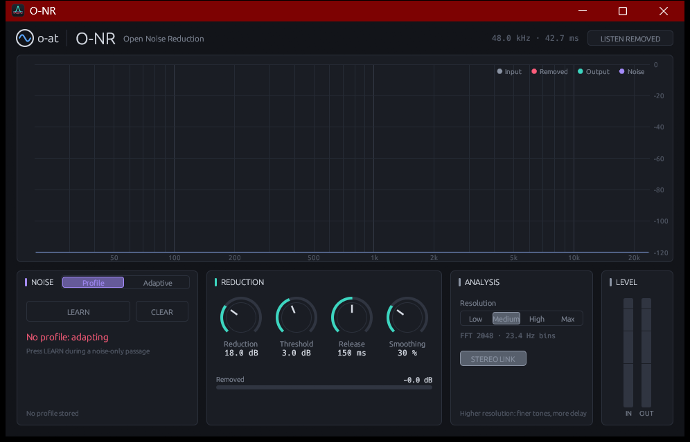

1. Play a passage of noise alone and press **LEARN**; press **STOP LEARNING** after a
   second or more. The signal passes unchanged while O-NR learns. The profile is stored
   with the session and works at any sample rate and resolution.
2. Set **Reduction** to how far the noise is lowered, and **Threshold** to how much
   above the profile still counts as noise. **LISTEN REMOVED** plays what is taken away:
   if you hear the signal in it, lower Threshold or Reduction.

Without a profile, or with **Adaptive** selected, O-NR tracks the noise floor under the
signal by itself. That follows steady noise (hiss, hum, fans, air conditioning) without
learning, but cannot tell noise from a sustained note held for longer than about 1.5 s.

| Control | Purpose |
| --- | --- |
| Noise source | **Profile** uses the learned profile; **Adaptive** tracks the noise floor. |
| Reduction | Largest attenuation, 0–60 dB. At 0 dB the output is the input, delayed. |
| Threshold | Offset of the noise estimate, −12 to +24 dB. Higher values remove more. |
| Release | How quickly attenuation returns after a sound ends, 10–1000 ms. Longer keeps reverb tails. |
| Smoothing | Fills narrow gaps between kept frequencies, for a less "watery" sound. |
| Resolution | FFT size: Low, Medium, High or Max (1024–8192 samples at 48 kHz, scaled with the rate). Higher resolution separates hum and steady tones from the signal; lower keeps attacks sharper. |
| Stereo link | One gain for both channels, which keeps the stereo image steady. |

The spectrum shows the input, the output, the removed part and the noise estimate in
use. O-NR delays the audio by its FFT size (at 48 kHz: 21 ms at Low, 43 ms at Medium, 171 ms at
Max) and reports it to the host, which compensates it; changing Resolution changes the
delay. See [Noise reduction design](docs/o-nr.md).

```bash
cargo xtask bundle o-nr --release
cargo run --release -p o-nr --features standalone --bin o-nr-standalone -- --backend wasapi --input-device "In 1-2 (Your Interface)"
```

## O-AUD-TX and O-AUD-RX

Two companion plugins and two applications route audio between hosts and devices
through named buses, for example from a DAW to a voice chat application's device or to
headphones on another interface.

- **O-AUD-TX** (VST3, CLAP) sends its track's audio to a bus with a name you choose.
  Its own output passes through unchanged, or is muted with **Thru** off.
- **O-AUD-RX** (VST3, CLAP) plays a bus inside any host, mixed with the track's input.
- The standalone **O-AUD-RX** application plays a bus on any output device. It uses the
  same receiver core and editor as the plugin.
- The standalone **O-AUD-TX** application sends any number of routes, each to its own
  bus: an input device, everything an output device plays (Windows loopback), or what a
  single application plays (Windows process loopback). It uses the same transmitter core
  and editor as the plugin. On Linux it sends input devices; to send what a device plays,
  choose its PipeWire or PulseAudio monitor as the input.

| O-AUD-TX | O-AUD-RX application |
| --- | --- |
| 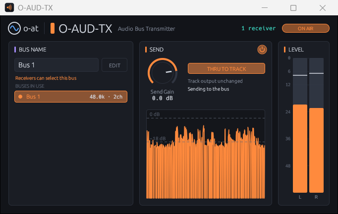 |  |

Buses live in shared memory and need no driver or server. Any number of receivers can
play one bus. O-AUD-RX resamples to its output rate and locks to the transmitter's clock,
so different devices, sample rates and buffer sizes work together without drift; the
editor shows the queued latency, its target, jitter, clock drift in ppm, dropouts and a
latency history.

Using them:

1. Insert O-AUD-TX where the audio should leave the host. It names itself `Bus 1`,
   `Bus 2` and so on; type another name if you like (up to 32 bytes, case-insensitive).
   If another O-AUD-TX uses the name, the editor offers a free one. Hosts such as Ableton
   Live keep keystrokes for their own shortcuts: then click **EDIT**, which opens the
   name in a small window of its own that always receives the keyboard.
2. In O-AUD-RX, pick the bus from the list, or type its name (or use **EDIT**). A name
   without a transmitter yet waits for one.
3. Set **Latency** to the buffering you want (2–250 ms, default 20 ms). O-AUD-RX raises
   its target automatically when the transmitter's or the device's blocks need more,
   and lowers it again slowly once they are steady.

The O-AUD-RX application remembers its bus, device and settings, and accepts
`--bus NAME` and `--device NAME`. On Windows the settings are stored in
`%APPDATA%\O-AUD-RX\settings.ini`.

The O-AUD-TX application sends **ROUTES**: each route takes one source to its own bus,
so one window can send a browser to `Bus 1`, a microphone to `Bus 2` and a media player
to `Bus 3`. **+ ADD** starts a route from the default input to a new bus; **REMOVE**
stops the selected one. Each row shows the route's bus, source, state and level; select a
route to edit its bus name, send controls and source on the right.

The **AUDIO SOURCE** panel lists input devices, output devices and applications. An output device sends whatever Windows mixes to it, from any
application. While capturing an output, the application keeps a silent stream open on
it, so the bus keeps running through silence. Don't play the bus on the device it
captures: that feeds back.

**APPLICATIONS** lists the programs that have audio sessions, marking those that play.
Picking one sends only what that program and its child processes play (Windows 10
version 2004 or later), whichever device it plays on, so a browser or a game can go to
its own bus while you keep listening to it. The source is remembered by executable name: when
the program is not running, the panel says so and the capture starts when it does, and
it follows the program when it restarts. While the program is quiet, the application
sends silence, so the bus keeps running.

It remembers its routes in `%APPDATA%\O-AUD-TX\settings.ini` (a file of an earlier
version becomes the first route), and accepts `--bus NAME`, `--input NAME`,
`--loopback NAME` (`default` selects the system default device) and `--application EXE`.
A bus and a source make a route; repeat them for more routes. They set the saved routes
in order and add routes as needed:

```powershell
o-aud-tx --bus Browser --application brave.exe --bus Voice --input default --bus Media --application vlc.exe
```

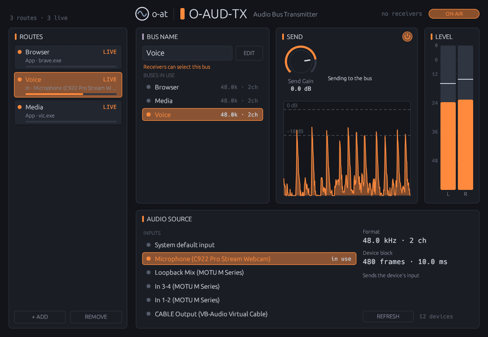

Build them with:

```bash
cargo xtask bundle o-aud-tx --release
```

```bash
cargo xtask bundle o-aud-rx --release
```

```bash
cargo build --release -p o-aud-rx-app
```

```bash
cargo build --release -p o-aud-tx-app
```

The bundles are written to `target/bundled/`, the applications to
`target/release/o-aud-rx.exe` and `target/release/o-aud-tx.exe`.

Limitations: buses carry up to 8 channels (the plugins use mono and stereo layouts, the
O-AUD-TX application sends up to 8 device channels); an application is captured in
stereo, and with all its child processes;
transmitter and receivers must run on the same computer and, on Windows, in the same
user session; a transmitter whose clock is more than 0.5 % off cannot be followed
without dropouts. See [Audio bus design](docs/audio-bus.md).

## O-AUD-A

**O-AUD-A** (VST3, CLAP and a standalone application) is an audio analyzer. Insert it
anywhere; it passes the audio through unchanged and reports no latency. Resize the
editor from its lower right corner. **FULL SCREEN** (or F11) takes the plugin window
full screen on Windows, without its frame; **RESTORE** or Esc brings it back. Hosts
cannot resize NIH-plug editors from their own window frame, so these are the ways to
change its size.


The tabs at the top select a page: the overview, or one view filling the editor. The
header shows the sample rate and channel layout, and whether a signal arrives:
**ANALYZING**, **NO SIGNAL**, or **OVERLOAD** when samples were dropped because the
analysis fell behind. Its pages, in this order, show:

| Page | What it shows | Options |
| --- | --- | --- |
| Overview | Any of the views at once, arranged as you like: switch each one on or off under **VIEWS**, drag a view's title onto another to move it beside, above or below it, and drag the gaps to resize. Narrow loudness panels show their numbers in a strip above the meters, and the history when it fits. | Seven views, up to four rows; reset layout |
| Spectral | Two layers: a sonogram, and on top of it the waveform of the same signal, aligned column by column (peak extent and RMS core), as in spectral editors. Its sonogram is independent of the Sonogram page: it has its own FFT, channels, scale, speed and range. | Sonogram layer: opacity, brightness, contrast and every sonogram option; waveform layer: opacity, gain (vertical zoom), linear or dB scale. The opacity sliders are logarithmic. |
| Spectrum | Spectrum of left and right, mid and side, or one signal, with peak hold and a hover readout of frequency, note and level. | FFT 1K–32K, Hann, Blackman-Harris or flat-top window, averaging (off to infinite), 1/24–1/3 octave smoothing, 0–6 dB/oct slope, 30–150 dB range, 20 kHz or Nyquist, log, linear or semitone (ST) frequency scale |
| Sonogram | Scrolling time × frequency image, newest on the right, with a hover readout. | FFT 1K–32K, one signal (mid, side, left or right) or two stacked lanes (L · R or M · S), log, linear or semitone (ST) frequency, 15–240 columns/s, 30–150 dB range |
| Scope | Oscilloscope of one or two signals, overlaid or stacked, triggered on a rising or falling level crossing with sub-sample alignment so periodic signals stand still; drag the T marker to set the level. Shows the frequency between crossings and a hover readout. | 1 ms – 60 s span (above 500 ms a scrolling roll view of the min/max envelope, without trigger); L·R, M·S or one signal; free, rising or falling trigger on mid, side, left or right; automatic or ×1–×32 gain |
| Stereo | Goniometer, correlation and balance, mid and side levels, the side-to-mid ratio (in the header), and the stereo position and width of 30 third-octave bands (red where they are out of phase). | M/S goniometer, polar sample cloud or L/R scope, each drawn as dots or lines; 512–4096 samples; automatic or fixed gain; band FFT length (shared with the spectrum) |
| Loudness | EBU R 128 / ITU-R BS.1770-4 momentary, short-term and integrated loudness, loudness range, true peak (4× oversampled), sample peak and PLR, bar meters and a loudness history, all on the diagrams' shared background and grid. The header shows the target and the measured time. PLATFORMS shows, in place of the history, what streaming platforms' normalization does to each shown signal. | Target presets −11 (Spotify Loud), −14 (Spotify, YouTube, Tidal, Amazon), −15 (Deezer), −16 (Apple Music, podcasts), −18 (AES streaming), −19 (Spotify Quiet), −23 (EBU R 128), −24 (ATSC A/85) LUFS or a custom target; LUFS or LU; 30 s to 10 min history; PLATFORMS; RESET in the panel header or in its settings |
| 3D | The spectrum history as ridges or a shaded surface, or the stereogram: level over stereo position and frequency. Drag to rotate, shift-drag or right-drag to move, wheel to zoom, double-click to reset. | 64–256 bands, 32–128 rows, 30–150 dB range, a 3D grid (floor, back walls and dB levels), camera rotation, elevation and zoom with RESET VIEW, FFT, one scene or two stacked ones (L · R or M · S, shared with the Sonogram page); its heat map is a color |

| | |
| --- | --- |
| 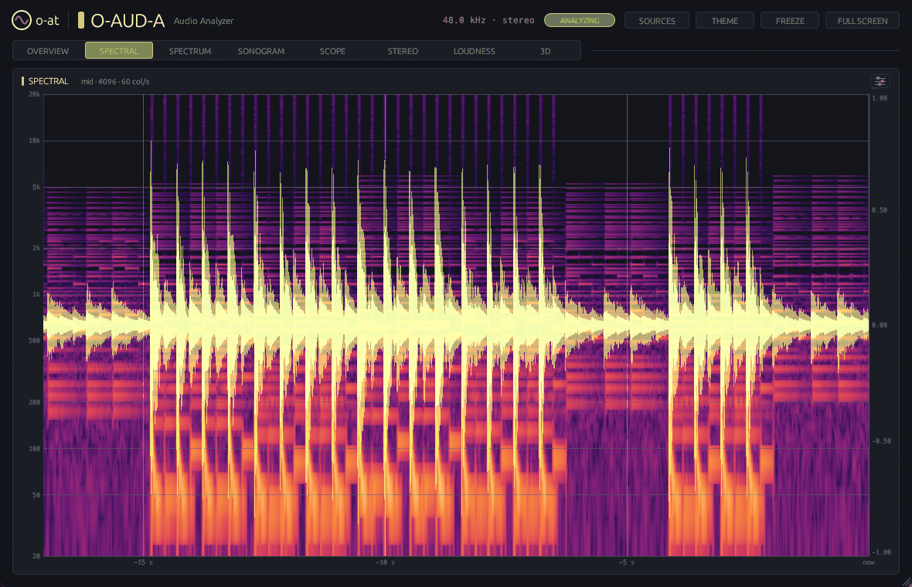 | 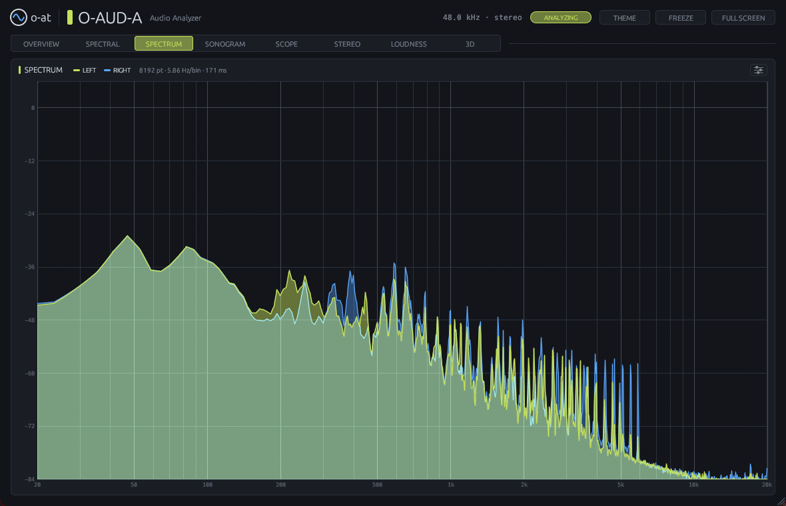 |
| **Spectral**: the waveform's peak extent and RMS core drawn over the sonogram; quiet passages and drum hits line up with their spectra. | **Spectrum**: left and right over a filled area; the header shows the FFT size, bin width and window length. |
| 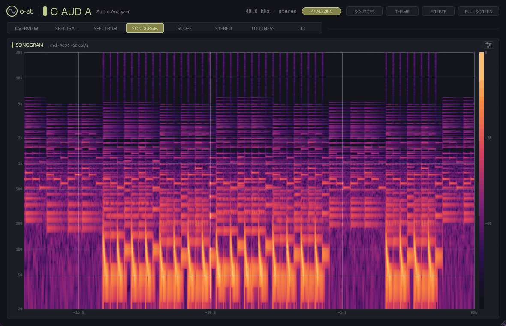 | 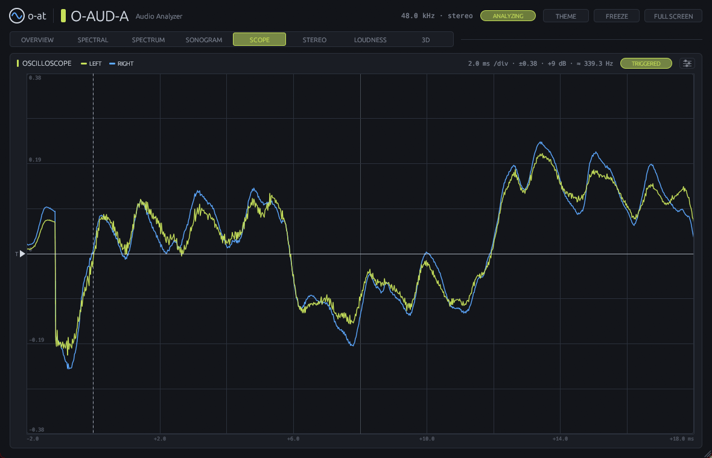 |
| **Sonogram**: the last 17 s at 60 columns/s, with the heat map's level scale on the right. | **Scope**: left and right overlaid, triggered at the T marker; the header shows the time base, the vertical scale, the gain and the measured frequency. |
| 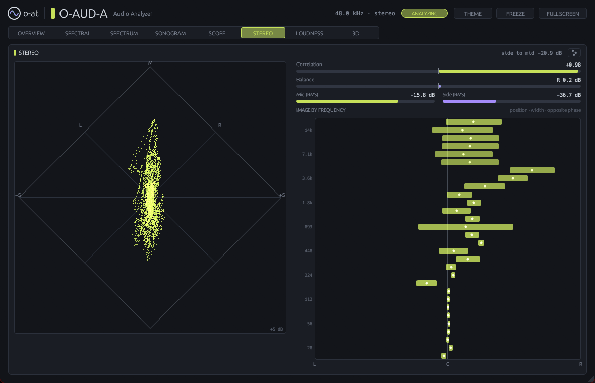 | 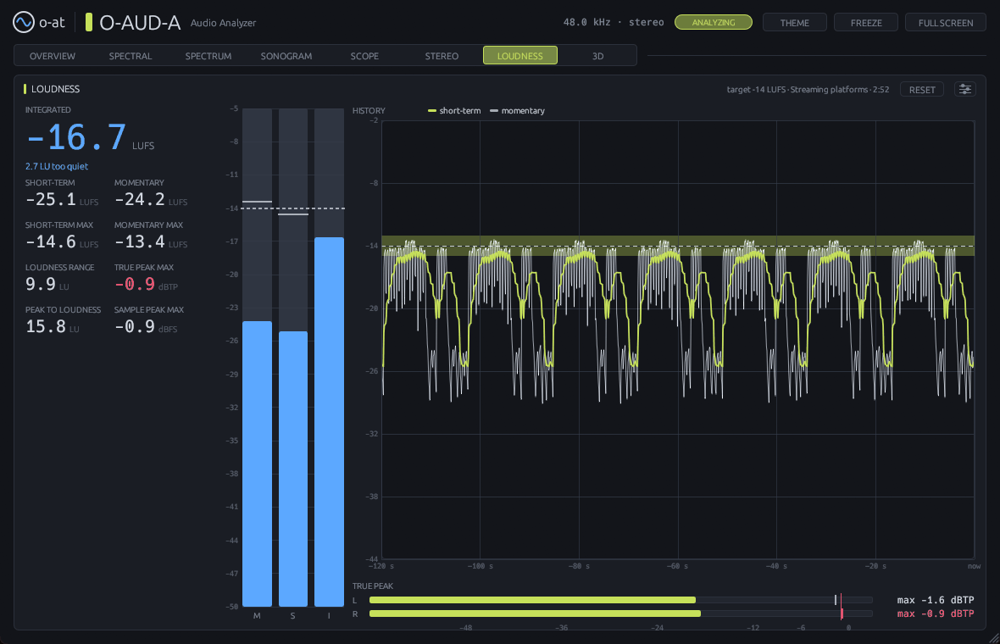 |
| **Stereo**: the goniometer, the meters, and each third-octave band's position (dot) and width (bar). | **Loudness**: integrated loudness against the target, the readouts, M, S and I bars, the history of short-term and momentary loudness and true peak per channel. |
| 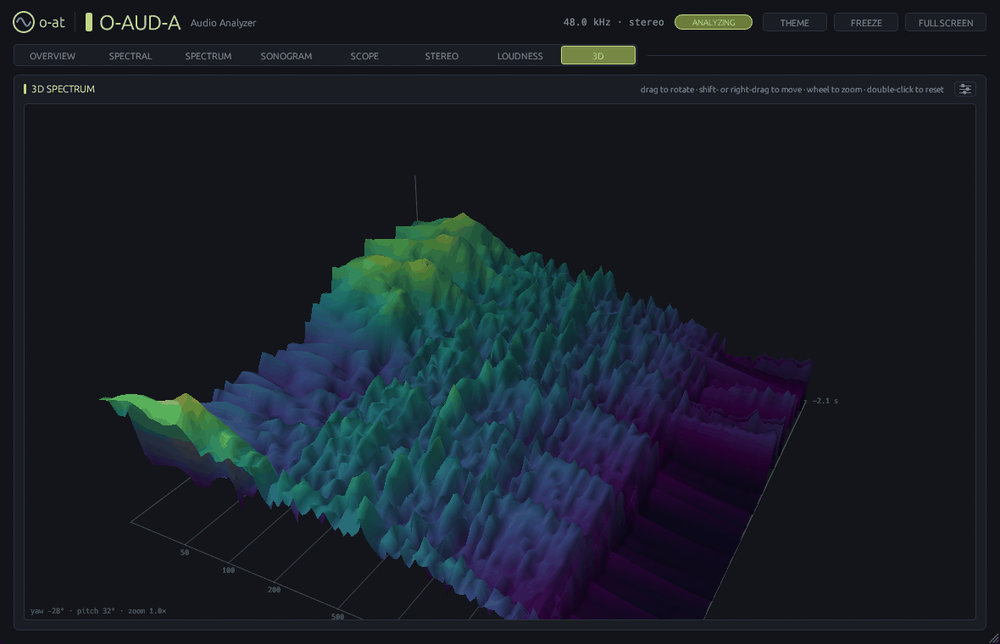 | 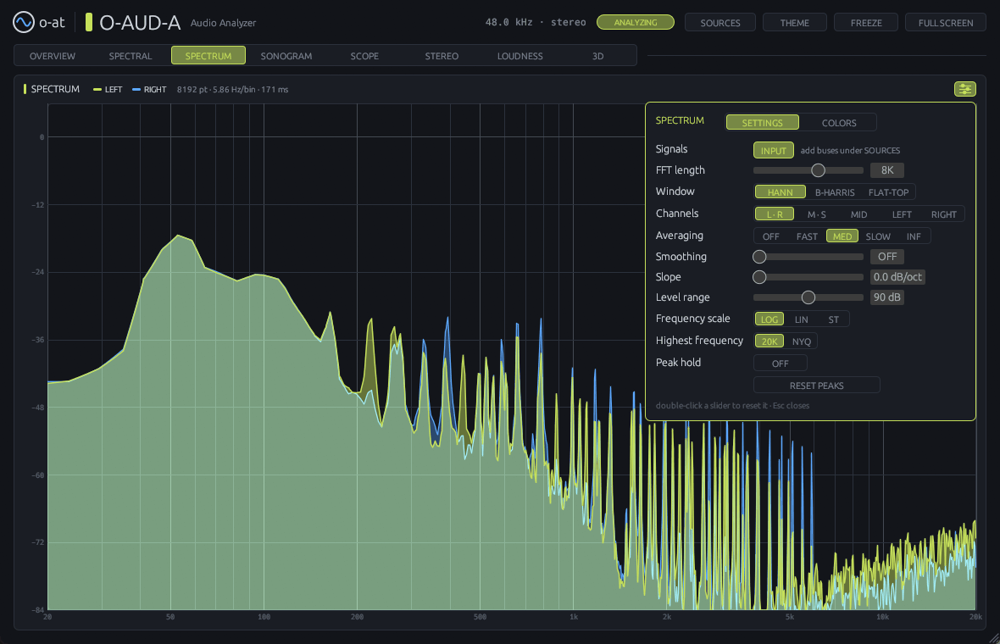 |
| **3D**: the spectrum history as a shaded surface with the 3D grid on; the footer shows the camera's yaw, pitch and zoom. | **Settings**: the spectrum's SETTINGS tab, with segmented selectors and sliders. |

The screenshots show a synthetic test piece: chords, bass, drums and a melody, panned
across the stereo field. The comparisons below add a louder, brighter and wider copy of
it as the bus **Reference**.

### Sources: comparing tracks and references

**SOURCES** in the header adds audio buses from [O-AUD-TX](#o-aud-tx-and-o-aud-rx) next
to the input, up to eight, each with a color of its own. The panel lists every source's
format and momentary, short-term and integrated loudness. Pick a live bus from the list
or type a name, which waits for its transmitter.

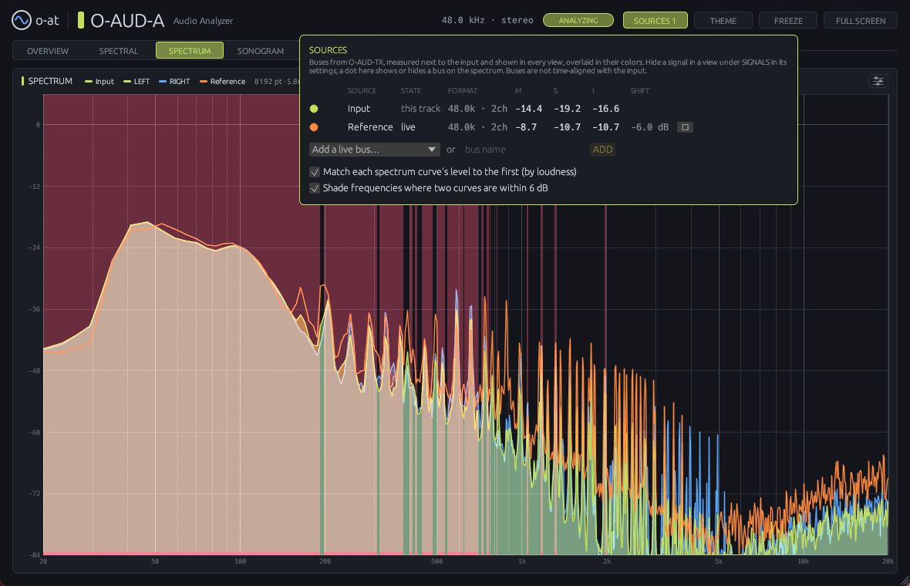

Every view chooses its signals under **SIGNALS** at the top of its settings: INPUT and
each listed bus, as toggles in their colors. One signal is drawn as usual, with all of
the view's settings; several are overlaid, each in its color and named in the header:

| View | Several signals |
| --- | --- |
| Spectrum | The first in full, the others as curves of their first channel |
| Sonogram, spectral | The images tinted in each signal's color; the waveforms in their colors |
| 3D | Ridge lines in each signal's color in one scene, also for the stereogram |
| Oscilloscope | Each signal's traces, triggered on its own audio, with one gain |
| Stereo | Goniometer dots in each color, a correlation meter each and their position per band |
| Loudness | The first's readouts and bars, every signal's short-term history and a comparison table |

Every view shows every listed bus until you hide it there; a source's dot in the panel
shows or hides it on the spectrum. Sessions from before per-view signals keep the
spectrum curves they had hidden. Removing a bus removes it from every view.

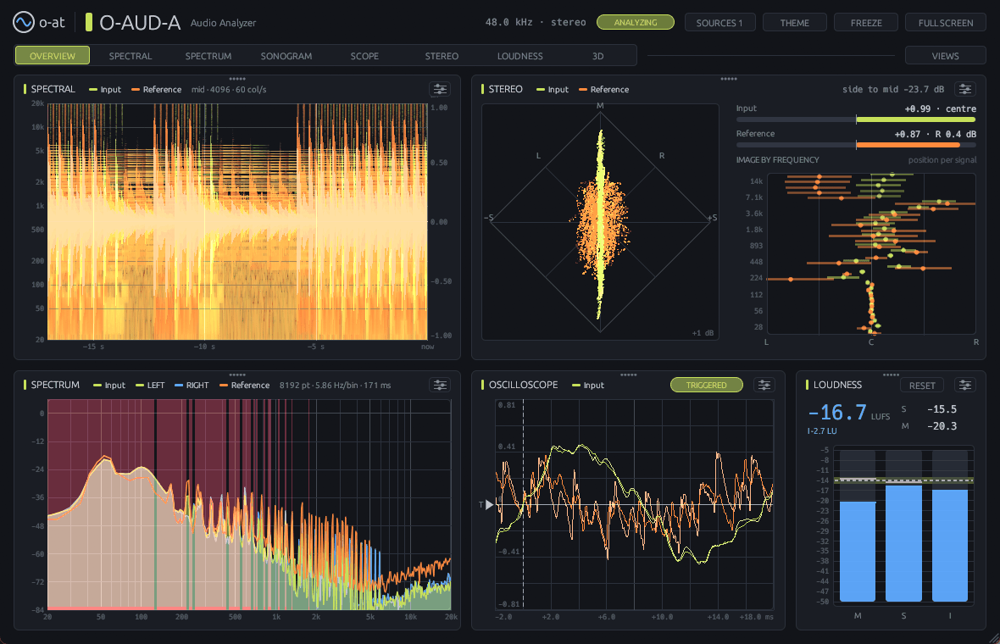

- **Match level** shifts each further spectrum curve by its loudness difference to the
  first (integrated loudness, short-term until that is measured), for comparisons at
  equal loudness, for example against a reference track.
- **Masking** shades the frequencies where the two loudest curves are within 6 dB of
  each other and above −60 dB, with a red strip along the bottom.

In a DAW, put O-AUD-TX last on the tracks or groups you want to compare (THRU on, so
the mix is unchanged) and O-AUD-A on the master, then add their buses. A reference
playing in another application reaches O-AUD-A through a route of the O-AUD-TX
application: pick the player under APPLICATIONS, or capture its output device. Buses are measured at their own sample rate, so their rates need not
match. Sources are not time-aligned with the input: overlays compare signals, they do
not line them up, and each oscilloscope trace has its own trigger. Sources and every
view's signals are saved with the session by name.

### Streaming platforms

**PLATFORMS** in the loudness header replaces the history with a table of streaming
platforms: their reference loudness and true peak ceiling, and for the shown signal the
gain the platform applies, the loudness and true peak after it and what happens:

- **turned down**: louder than the reference; the extra loudness is lost.
- **left quieter**: the platform only turns down (YouTube, Amazon Music, Tidal, Deezer),
  so a quieter track stays quieter than its neighbours.
- **held by peak**: the platform turns up only until the true peak reaches its ceiling
  (Spotify, Apple Music), so a quiet, peaky track stays quieter.
- **limited**: Spotify Loud turns up all the way and limits the peaks.
- A red true peak is above the ceiling after the gain, where lossy encoding may clip.

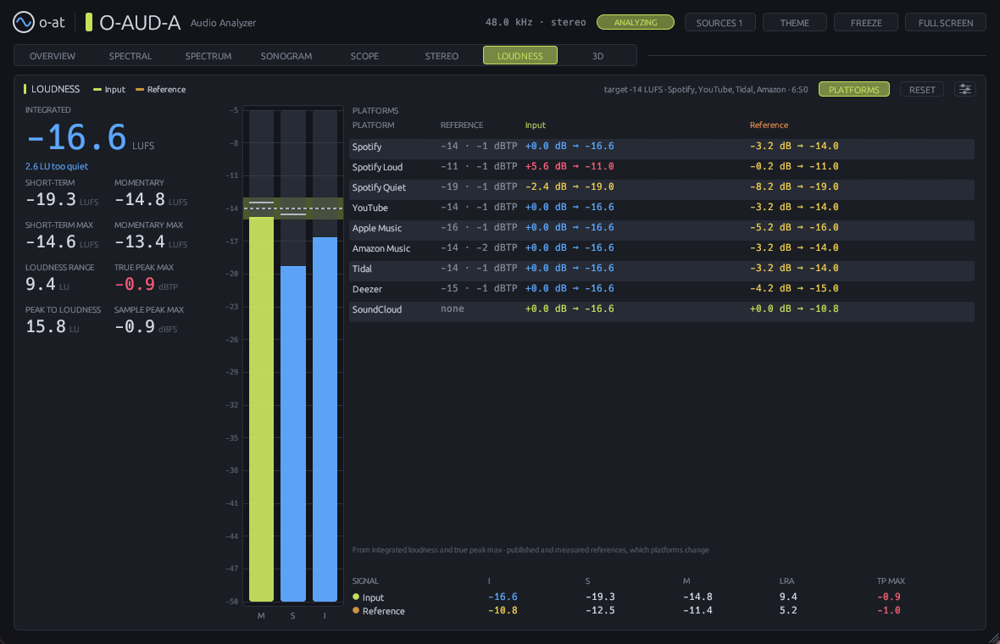

It works from the integrated loudness and the true peak maximum, so play the whole
track (or the loudest part, for a quick check). With several signals, each has a column
with its gain and resulting loudness: compare a master with a reference as the
platform will play them. The references are published or commonly measured values
(see [the design notes](docs/o-aud-a.md#streaming-platforms)); platforms change them.

### Settings and colors

Every view has a popup, opened with the button at the right end of its header or by
**right-clicking the diagram**, on its page and in the overview alike.

- Its **SETTINGS** tab holds what the view shows: segmented selectors for kinds (window,
  channels, scale) and sliders for ranges and steps (FFT length, level range, slope,
  speed, time span). Double-click a slider to reset it. Headings mark settings shared
  with another view, for example the 3D view's analysis, which is the Sonogram page's.
- Its **COLORS** tab holds the view's colors, each with a color picker and, where it
  applies, an opacity, brightness or contrast slider. Examples: the spectrum's left/mid,
  right and side curves, fill and peak hold; the loudness meter's short-term and
  momentary lines and its on-target, too-loud and too-quiet colors; the heat map of
  the sonogram, spectral and 3D views (four built-in maps or three custom colors).
  **Reset this view's colors** restores the defaults.
- Every view keeps its own colors, on its page and in the overview. The diagrams'
  background and grid are shared by every view and appear in each COLORS tab.
- Esc or a click outside closes the popup.

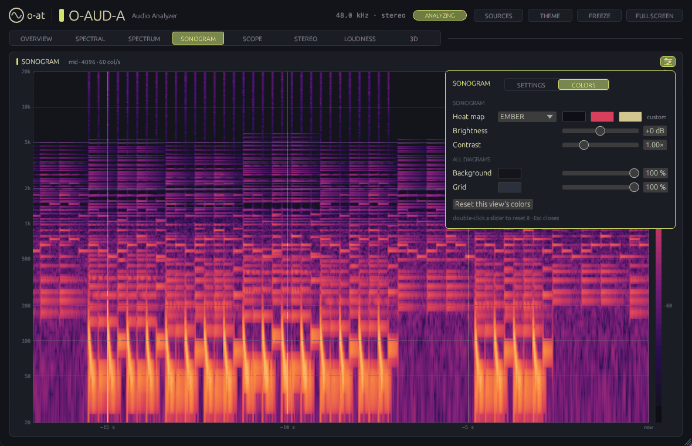

**THEME** colors only the controls (buttons, tabs, sliders, panel marks), with a preset
(O-AT, Phosphor, Sunset, Ocean, Mono, Contrast with Okabe-Ito colors) or an accent of
your own. **FREEZE** holds the display while the measurements continue. The settings,
the layout and the selected page are stored with the session.

In the overview, the **VIEWS** button at the right end of the tabs opens a panel that
shows or hides each view; its **RESET LAYOUT** restores the default arrangement. Drag
a view's title onto another view to move it beside, above or below that view, and drag
the gaps between views to resize them.

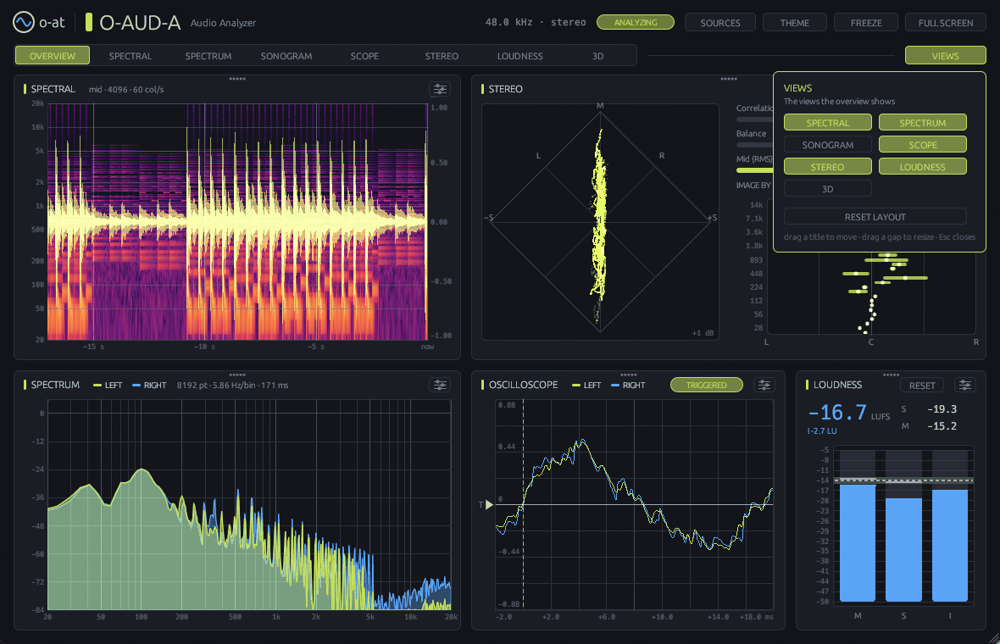

The audio thread only copies samples into a lock-free ring. A worker thread measures
them: loudness and stereo meters all the time, so integrated loudness keeps counting
while the editor is closed, and the FFT views only while the editor is open. See
[Analyzer design](docs/o-aud-a.md).

```bash
cargo xtask bundle o-aud-a --release
```

```bash
cargo run --release -p o-aud-a --features standalone --bin o-aud-a-standalone -- --backend wasapi --input-device "In 1-2 (Your Interface)"
```

The standalone application analyzes the input device named by `--input-device` (without
it, no input is connected; an unknown name lists the available devices) and outputs
silence.

## Built on

- [NIH-plug](https://github.com/robbert-vdh/nih-plug) for the VST3/CLAP wrappers and
  [egui](https://github.com/emilk/egui) editor integration (pinned revision).
- [nnnoiseless](https://github.com/jneem/nnnoiseless), a Rust port of Xiph's
  [RNNoise](https://github.com/xiph/rnnoise).
- [DeepFilterNet](https://github.com/Rikorose/DeepFilterNet) 0.5.6 (libDF) with its
  DeepFilterNet3 model, running on [tract](https://github.com/sonos/tract), and
  [rtrb](https://github.com/mgeier/rtrb) for the lock-free worker queues.
- [realfft](https://github.com/HEnquist/realfft)/[RustFFT](https://github.com/ejmahler/RustFFT),
  [rubato](https://github.com/HEnquist/rubato), [biquad](https://github.com/korken89/biquad-rs)
  and [triple_buffer](https://github.com/HadrienG2/triple-buffer).

The echo canceller follows the multidelay block frequency-domain design used by
Speex (Valin, 2007) and is implemented here on top of realfft.

## Known limitations of O-NEC

- RNNoise targets realistic noise such as fans, hum and traffic. Loud, flat white
  noise is reduced less. Very non-stationary noise (keyboard clicks) may leak; use
  DeepFilterNet for it.
- DeepFilterNet treats steady synthetic tones as noise, so test it with real speech.
  Both models are tested with synthetic signals only, not with recorded speech.
- Echo cancellation needs a clean reference; with clock drift between separate
  playback and capture devices, performance degrades over time.
- The editor has a fixed size of 1200 × 680 logical pixels. Hosts restore the editor
  size saved with a session, so sessions saved with an earlier, narrower O-NEC open
  with the right-hand panels cut off until O-NEC is added again.
- The speech leveler relies on the voice detector. Whispering has little voicing and
  may be detected less reliably than normal speech; it is tested with synthetic vowels,
  not recorded whispering.

## Releases

Pushing a tag `vX.Y.Z` that matches the workspace version in the root `Cargo.toml` runs the
[release workflow](.github/workflows/release.yml): it runs every CI check, builds the
VST3 and CLAP bundles and the five applications for Windows and Linux, and publishes a
GitHub release with `O-AT-X.Y.Z-windows-x64.zip` and `O-AT-X.Y.Z-linux-x64.tar.gz`
(installation notes in [INSTALL.txt](packaging/INSTALL.txt) and
[INSTALL-linux.txt](packaging/INSTALL-linux.txt)) and their SHA-256 checksums. The Linux
build is made on Ubuntu 22.04 and needs glibc 2.35 or later.

Minor releases can be Windows-only: write `windows-only` in the annotated tag's message,
or untick **Linux** when starting the workflow by hand. CI then skips the Linux build and
the release has only the Windows package. The project site's download buttons always link
to the newest release that has each platform's package.

```bash
git tag -a v0.6.2 -m "v0.6.2 windows-only"
git push origin v0.6.2
``` The workflow can also be
started by hand with a version.

[CI](.github/workflows/ci.yml) runs on every push to `main` and every pull request: the
Windows checks and bundles, a build with the minimum supported Rust (`rust-version` in
`Cargo.toml`, currently 1.88) and the audio bus tests on Linux. The
[RealtimeSanitizer workflow](.github/workflows/rtsan.yml) runs nightly and on pull
requests that change the code. The [project site](https://baalintnagy.github.io/o-at/) is
built from this README and `docs/` by the [Pages workflow](.github/workflows/pages.yml).

The executables embed their icons and version information. The icons are generated
from vector shapes; regenerate them after changing [the generator](tools/icons/generate.py)
with `python tools/icons/generate.py` (requires Pillow).

## License

The O-AT source code is licensed under the [MIT License](LICENSE). Built VST3 binaries
include GPLv3-licensed VST3 bindings; see [NOTICE](NOTICE.md).
