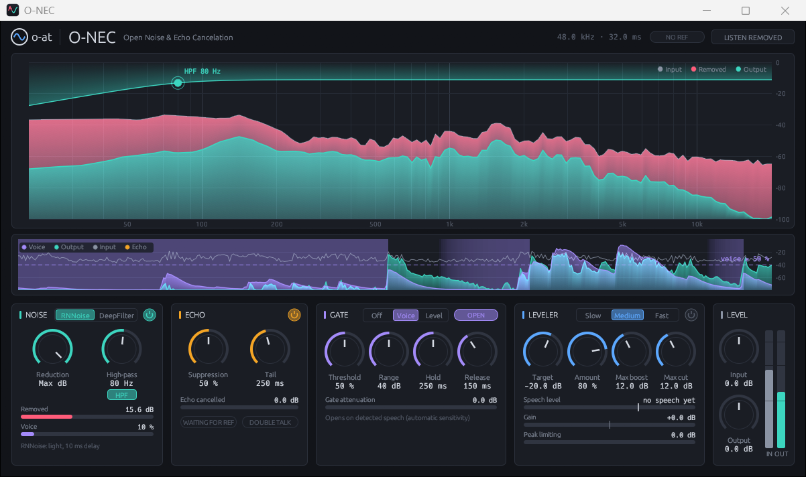
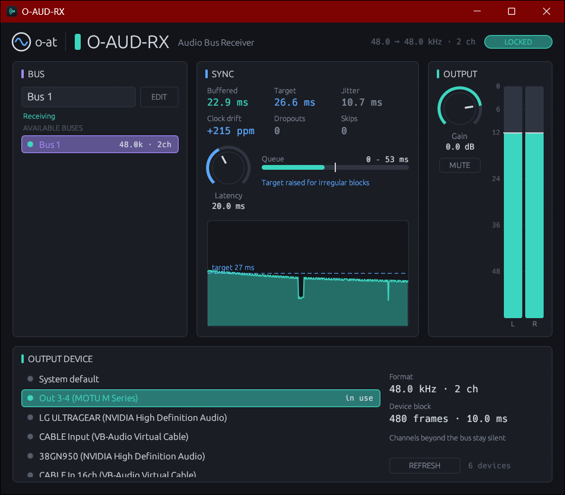

# O-AT

**Open Audio Tools**: open source audio plugins and applications written in Rust.

| Tool | Purpose |
| --- | --- |
| [O-NEC](#o-nec) | Voice cleanup: noise suppression, echo cancellation, voice gate and speech leveler. |
| [O-AUD-TX and O-AUD-RX](#o-aud-tx-and-o-aud-rx) | Route audio between hosts, applications and devices through named buses. |

The tools are listed under the vendor `o-at` in plugin hosts. O-NEC, O-AUD-TX and
O-AUD-RX replace the earlier ONEC, AUD-TX and AUD-RX plugins. Their plugin IDs are new
(CLAP `o-at.o-nec`, `o-at.o-aud-tx`, `o-at.o-aud-rx`), so sessions saved with the earlier
plugins do not load them; replace the earlier plugins in those sessions.

## O-NEC

**Open Noise and Echo Cancelation** is a VST3 and CLAP voice cleanup plugin written in
Rust. It does what the noise suppression and echo cancellation built into voice chat
applications do, as a plugin you can put on any microphone chain, with adjustable
parameters and detailed visual feedback.



### What it does

| Stage | Purpose |
| --- | --- |
| Input gain and high-pass | Level trim and rumble removal (2nd-order Butterworth, 20–400 Hz). |
| Echo canceller | Learns the loudspeaker-to-microphone echo path from the sidechain and subtracts it. |
| Residual echo suppressor | Removes echo left by the linear canceller (non-linearities, tail, path changes). |
| Noise suppression | Removes background noise while keeping speech, with a choice of two neural models: RNNoise or DeepFilterNet3. |
| Voice gate | Opens on detected speech or above a level, like automatic or manual input sensitivity. |
| Speech leveler | Optional. Raises whispering or distant talk and lowers shouting towards a target level, measured only while someone speaks, and limits the peaks of sudden shouts. |
| Output gain | Final level trim. |

The editor shows:

- A spectrum analyzer with input, output and echo reference spectra. The pink area
  between input and output is what O-NEC removes. Hover for per-frequency readouts.
- A draggable high-pass filter handle with its response curve (double-click toggles it).
- A 4-second activity timeline of input and output levels, voice probability, gate
  state, echo reference activity and the speech leveler's gain, with a draggable gate
  threshold.
- Removed noise, voice probability, echo cancellation (ERLE), gate attenuation, speech
  level, leveler gain and peak limiting meters; echo canceller state (waiting, learning, locked, double talk); peak meters.
- **Listen removed** solos what the chain takes away, to tune settings without
  damaging speech.

The noise panel's **RNNoise / DeepFilter** switch selects the noise model. A line below
its meters shows the model's state, including when RNNoise fills in for DeepFilterNet
while it loads or during CPU overload.

Knobs: drag vertically, hold Shift for fine adjustment, use the mouse wheel, and
double-click to reset.

### Noise models

| | RNNoise | DeepFilterNet3 |
| --- | --- | --- |
| Designed for | Steady noise: fans, hum, traffic | Also non-stationary noise, such as keyboards |
| Stage delay | 10 ms | 30 ms plus 20–30 ms of scheduling slack |
| Total latency at 48 kHz | 32 ms | 72 ms (buffers up to 480 samples), 82 ms (up to 960) |
| CPU | Lowest | About 0.6 ms per 10 ms frame, on its own thread |

RNNoise is the default. Select DeepFilterNet for the strongest suppression when the extra
delay is acceptable. Switching models changes the latency reported to the host.

DeepFilterNet's inference allocates memory, so it cannot run on the audio thread. It runs
on a worker thread, and its results are used a fixed number of frames later: one more
than a single host buffer can hold, which is the scheduling slack above. If the computer
cannot keep up, RNNoise's time-aligned output fills in for the missing frames. RNNoise also
keeps running in DeepFilterNet mode to provide the voice probability for the gate.

### Echo cancellation needs a reference

A voice chat application cancels echo because it knows what it plays to your
speakers. A plugin only knows what its host gives it, so O-NEC takes the far-end
signal (what your speakers play) on its **Echo Reference** sidechain input. Without a
reference, the echo stages stay idle and O-NEC works as a noise suppressor and gate.

Route the speaker signal to the sidechain in your host: a DAW's sidechain routing, a
loopback device in a virtual mixer, or any VST3 host that exposes auxiliary inputs.
The reference must not pass through O-NEC's output. Speaker-to-microphone delays up to
the **Tail** setting (50–500 ms) are covered; set it a little above your system's
output-plus-input latency plus room reverberation.

### Parameters

| Parameter | Range | Default | Notes |
| --- | --- | --- | --- |
| Noise Suppression | on/off | on | RNNoise keeps running for the voice detector. |
| Noise Model | RNNoise, DeepFilter | RNNoise | Changes the latency. |
| Noise Reduction | 0–100 dB, Max | Max | Limits attenuation by mixing in the aligned dry signal. |
| High-Pass, Frequency | on/off, 20–400 Hz | on, 80 Hz | |
| Echo Cancellation | on/off | on | Needs the sidechain reference. |
| Echo Suppression | 0–100 % | 50 % | Residual echo suppression strength. |
| Echo Tail | 50–500 ms | 250 ms | Modeled echo path length. |
| Gate | Off, Voice, Level | Voice | |
| Voice / Level Threshold | 0–100 %, −80–0 dB | 50 %, −50 dB | |
| Gate Range, Hold, Release | 0–80 dB, 0–1000 ms, 10–1000 ms | 40 dB, 250 ms, 150 ms | |
| Speech Leveler | on/off | off | |
| Leveler Speed | Slow, Medium, Fast | Medium | How quickly the gain follows the speaker. |
| Leveler Target | −40 to −6 dBFS | −20 dBFS | Mean level of speech to reach. |
| Leveler Amount | 0–100 % | 80 % | Share of the level difference corrected. |
| Leveler Max Boost, Max Cut | 0–30 dB | 12 dB each | Limits of the gain. |
| Input / Output Gain | ±24 dB | 0 dB | |
| Listen Removed | on/off | off | Outputs input minus output. |

### Latency and formats

O-NEC processes 10 ms frames at 48 kHz internally, the native format of RNNoise and
DeepFilterNet.
Other host rates that are whole multiples of 100 Hz (8–192 kHz, including 44.1 kHz)
are converted with rubato's synchronous FFT resampler. Latency is reported to the host:
32 ms at 48 kHz with RNNoise (frame collection, residual echo suppressor and RNNoise, 10 ms
each, and the leveler's 2 ms lookahead), slightly more with resampling. With DeepFilterNet, see [Noise models](#noise-models).
22.05 and 11.025 kHz are not supported.

Mono and stereo layouts are available. Stereo input is mixed to mono, processed, and
written to both outputs.

### Build

Requires Rust 1.85 or later (edition 2024). On Windows, use the MSVC toolchain.

```bash
cargo xtask bundle o-nec --release
```

Bundles are written to `target/bundled/O-NEC.vst3` and `target/bundled/O-NEC.clap`.
Copy the VST3 bundle to your VST3 folder, for example
`C:\Program Files\Common Files\VST3` on Windows.

To try the plugin without a host:

```bash
cargo run --release --features standalone --bin o-nec-standalone -- --help
```

On Linux, building the editor needs X11, XCB and OpenGL development packages.

### Verify

```bash
cargo fmt --all -- --check
cargo clippy --workspace --all-targets --features o-nec/standalone,o-aud-tx/standalone -- -D warnings
cargo test --release
cargo test --test realtime
cargo test -p audbus -p o-aud-tx -p o-aud-rx
```

The tests cover echo canceller convergence (over 25 dB ERLE) and near-end
preservation during double talk, residual echo suppression, latency alignment and noise
reduction of both noise models, the RNNoise fallback for missing DeepFilterNet frames, gate timing and hysteresis, analyzer calibration, reported versus
measured latency at several host rates and buffer sizes for both models, and the
complete chain at 44.1 kHz with both models. The `realtime` test runs the chain with both
models, editor analysis and reset under NIH-plug's allocation guard; it only checks in
debug builds. A performance test requires the full chain with a 500 ms tail to run at
least 20 times (RNNoise) or 5 times (DeepFilterNet) faster than real time in release
builds.

The VST3 bundle passes [pluginval](https://github.com/Tracktion/pluginval) 1.0.4 at
strictness level 10, both as a release build and as a debug build with allocation
checks enabled:

```bash
pluginval --strictness-level 10 --validate target/bundled/O-NEC.vst3
```

See [DSP design](docs/dsp.md) and [source style](docs/source-style.md).

## O-AUD-TX and O-AUD-RX

Two companion plugins and an application route audio between hosts and devices
through named buses, for example from a DAW to a voice chat application's device or to
headphones on another interface.

- **O-AUD-TX** (VST3, CLAP) sends its track's audio to a bus with a name you choose.
  Its own output passes through unchanged, or is muted with **Thru** off.
- **O-AUD-RX** (VST3, CLAP) plays a bus inside any host, mixed with the track's input.
- The standalone **O-AUD-RX** application plays a bus on any output device. It uses the
  same receiver core and editor as the plugin.

| O-AUD-TX | O-AUD-RX application |
| --- | --- |
|  |  |

Buses live in shared memory and need no driver or server. Any number of receivers can
play one bus. O-AUD-RX resamples to its output rate and locks to the transmitter's clock,
so different devices, sample rates and buffer sizes work together without drift; the
editor shows the queued latency, its target, jitter, clock drift in ppm, dropouts and a
latency history.

Using them:

1. Insert O-AUD-TX where the audio should leave the host. It names itself `Bus 1`,
   `Bus 2` and so on; type another name if you like (up to 32 bytes, case-insensitive).
   If another O-AUD-TX uses the name, the editor offers a free one. Hosts such as Ableton
   Live keep keystrokes for their own shortcuts: then click **EDIT**, which opens the
   name in a small window of its own that always receives the keyboard.
2. In O-AUD-RX, pick the bus from the list, or type its name (or use **EDIT**). A name
   without a transmitter yet waits for one.
3. Set **Latency** to the buffering you want (2–250 ms, default 20 ms). O-AUD-RX raises
   its target automatically when the transmitter's or the device's blocks need more,
   and lowers it again slowly once they are steady.

The application remembers its bus, device and settings, and accepts
`--bus NAME` and `--device NAME`. On Windows the settings are stored in
`%APPDATA%\O-AUD-RX\settings.ini`.

Build them with:

```bash
cargo xtask bundle o-aud-tx --release
```

```bash
cargo xtask bundle o-aud-rx --release
```

```bash
cargo build --release -p o-aud-rx-app
```

The bundles are written to `target/bundled/`, the application to
`target/release/o-aud-rx.exe`. O-AUD-TX also builds as a standalone application that sends
an audio input to a bus (`cargo run --release -p o-aud-tx --features standalone --bin
o-aud-tx-standalone`).

Limitations: buses carry up to 8 channels (the plugins use mono and stereo layouts);
transmitter and receivers must run on the same computer and, on Windows, in the same
user session; a transmitter whose clock is more than 0.5 % off cannot be followed
without dropouts. See [Audio bus design](docs/audio-bus.md).

## Built on

- [NIH-plug](https://github.com/robbert-vdh/nih-plug) for the VST3/CLAP wrappers and
  [egui](https://github.com/emilk/egui) editor integration (pinned revision).
- [nnnoiseless](https://github.com/jneem/nnnoiseless), a Rust port of Xiph's
  [RNNoise](https://github.com/xiph/rnnoise).
- [DeepFilterNet](https://github.com/Rikorose/DeepFilterNet) 0.5.6 (libDF) with its
  DeepFilterNet3 model, running on [tract](https://github.com/sonos/tract), and
  [rtrb](https://github.com/mgeier/rtrb) for the lock-free worker queues.
- [realfft](https://github.com/HEnquist/realfft)/[RustFFT](https://github.com/ejmahler/RustFFT),
  [rubato](https://github.com/HEnquist/rubato), [biquad](https://github.com/korken89/biquad-rs)
  and [triple_buffer](https://github.com/HadrienG2/triple-buffer).

The echo canceller follows the multidelay block frequency-domain design used by
Speex (Valin, 2007) and is implemented here on top of realfft.

## Known limitations of O-NEC

- RNNoise targets realistic noise such as fans, hum and traffic. Loud, flat white
  noise is reduced less. Very non-stationary noise (keyboard clicks) may leak; use
  DeepFilterNet for it.
- DeepFilterNet treats steady synthetic tones as noise, so test it with real speech.
  Both models are tested with synthetic signals only, not with recorded speech.
- Echo cancellation needs a clean reference; with clock drift between separate
  playback and capture devices, performance degrades over time.
- The editor has a fixed size of 1200 × 680 logical pixels. Hosts restore the editor
  size saved with a session, so sessions saved with an earlier, narrower O-NEC open
  with the right-hand panels cut off until O-NEC is added again.
- The speech leveler relies on the voice detector. Whispering has little voicing and
  may be detected less reliably than normal speech; it is tested with synthetic vowels,
  not recorded whispering.

## Releases

Pushing a tag `vX.Y.Z` that matches the version in `Cargo.toml` runs the
[release workflow](.github/workflows/release.yml): it runs every CI check, builds the
VST3 and CLAP bundles and the three applications, and publishes a GitHub release with
`O-AT-X.Y.Z-windows-x64.zip` (installation notes in
[INSTALL.txt](packaging/INSTALL.txt)) and its SHA-256 checksum. The workflow can also be
started by hand with a version.

The executables embed their icons and version information. The icons are generated
from vector shapes; regenerate them after changing [the generator](tools/icons/generate.py)
with `python tools/icons/generate.py` (requires Pillow).

## License

The O-AT source code is licensed under the [MIT License](LICENSE). Built VST3 binaries
include GPLv3-licensed VST3 bindings; see [NOTICE](NOTICE.md).
