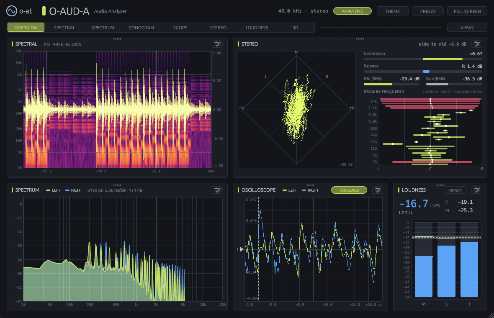

# O-AUD-A design

O-AUD-A is an analyzer plugin. It passes its audio through unchanged and reports no
latency; everything it does happens off the audio thread. This document describes how
it works; the [README](../README.md#o-aud-a) describes its pages and controls, with
screenshots of each page in [o-aud-a/](o-aud-a/).



## Threads

| Thread | Work |
| --- | --- |
| Audio | `Capture::push` copies the input into an `rtrb` ring of 131 072 stereo frames (2.7 s at 48 kHz). A mono input fills both sides. Frames that do not fit are counted as dropped; the editor then shows OVERLOAD. |
| Analysis worker | Drains the ring every 4 ms and runs every measurement. It may allocate. Results go to a `Published` record behind a mutex. |
| Editor | Takes the results once per frame, keeps its own copy (kept while frozen) and draws. |

The audio thread never takes the mutex, so the editor and the worker cannot block it.
Settings travel the other way through an `RwLock` that the worker reads each round;
the same lock is the persisted plugin state.

Loudness and the stereo meters run all the time. The FFT analyses (spectrum, sonogram,
3D) only run while an editor has drawn within the last 0.75 s, so a closed editor costs
almost nothing.

## Spectrum

The worker keeps the last 32 768 frames. At 60 Hz it windows the latest FFT length
(1 024–32 768) of both channels and transforms them with realfft. Bins are scaled so a
full-scale sine reads 0 dB with any window (Hann, 4-term Blackman-Harris, 5-term
flat-top); mid and side are `(L ± R) / 2`.

- Averaging is exponential in the power domain with 80 ms, 300 ms or 1.2 s time
  constants, or the running mean for INF.
- Fractional-octave smoothing averages power over ±½ of the bandwidth around each bin,
  using prefix sums.
- Peak hold keeps the highest smoothed level per bin until reset.
- The editor maps bins to pixel columns: the strongest bin where a column covers bins,
  linear interpolation where it falls between two, and adds the display slope around
  1 kHz.

## Sonogram and 3D

The sonogram has its own FFT, taken at its speed (15–240 columns/s). Each column has
512 rows from 20 Hz (log) or 0 Hz (linear) to 20 kHz or the Nyquist frequency. The
editor keeps 1 024 columns as a ring in a texture, uploads only new columns, and draws
the ring as two textured rectangles. The quietest 15 % of the heat map fades to
transparent, so silence shows the diagrams' shared background.

The 3D views use the sonogram's FFT length at 30 rows/s: 64–256 logarithmic bands from
20 Hz to 20 kHz. The stereogram distributes each bin's power by its equal-power pan
position, `atan2(|R|, |L|)`, into 49 columns per band and decays with a 0.35 s time
constant; the real part of the cross spectrum colors cells with opposite phase.
Surfaces are drawn as egui meshes with quads sorted far to near and simple diffuse
shading. The optional 3D grid (`grid`) draws the floor and the two walls farther from
the camera, chosen each frame from the camera's position, with level lines every 10,
20 or 30 dB down from 0 dB.

The spectral view has a sonogram of its own: the worker runs a second sonogram stage
with the spectral view's settings (`spectral.sonogram`) and publishes it as a feed of
its own, and the editor keeps a second ring and texture. Sessions of earlier versions,
where the spectral view shared the sonogram's settings, start from a copy of them. On
top of its sonogram the spectral view draws the waveform each column covers: the worker
records the minimum, maximum and RMS of the column's signal between two columns. Each pixel column shows the peak extent and, brighter, ±RMS, on a
linear scale or in dB from −60 dBFS at the centre line. Each layer has its own
opacity; the waveform's gain zooms it vertically (0–36 dB), and the sonogram's
brightness (±30 dB level offset) and contrast (0.3–3×, the slope of the color scale
around its middle) set how strongly the image reads.

With CHANNELS set to L · R or M · S, the sonogram (and with it the 3D views) or the
spectral view show two lanes, one above the other: every sonogram column then carries the levels and the
waveform extent of both signals, the editor's texture holds both lanes, and the 3D
history rows hold both band sets, each drawn as its own scene with the same camera.
Changing CHANNELS restarts that sonogram.

## Stereo

Correlation, balance and mid and side levels are exponential averages over 0.3 s,
updated per sample. The panel gives its space to the diagrams: the meters take three
rows (mid and side share one) and the side-to-mid ratio is in the header. Per third-octave band (30 bands), the spectrum FFT gives channel
powers and the real cross power, averaged over 0.25 s; the editor draws each band at
its pan position with a width of `(1 − correlation) / 2`.

The goniometer shows side across and mid up, with full scale on the diamond; the polar
mode folds samples into the upper half-plane. Automatic gain falls at once and rises by
3 % per frame.

## Oscilloscope

With each spectrum update (60 Hz) the worker publishes the latest frames: twice the
oscilloscope span, at least 4 096 and at most 32 768 (the history), so long spans at
high rates are shortened and say so. The editor finds the latest crossing of the
trigger level that still leaves a full span after it: the trigger arms when the source
falls 2 % of the screen below the level and fires when it reaches the level, and the
crossing is interpolated between samples, so periodic waveforms do not jitter. The
trigger point sits at 10 % of the width; without a crossing the newest span is shown.
The time between the last two crossings gives the frequency readout.

Spans longer than two samples per pixel are drawn as the extent of each pixel column;
short spans as lines through the samples, with dots when they are far apart. Automatic
gain falls at once and rises by 3 % per frame, like the stereo scope's.

Spans above 500 ms do not fit the sample history. For them the worker records an
envelope all the time: the minimum and maximum of mid, side, left and right per
millisecond, 65 536 buckets (about 65 s). New buckets reach the editor like sonogram
columns, and the oscilloscope draws them scrolling, newest on the right, without a
trigger (ROLL).

## Loudness

ITU-R BS.1770-4 and EBU R 128:

- K-weighting from the BS.1770 analog prototypes at any rate (the derivation used by
  libebur128), in double precision.
- 100 ms blocks. Momentary loudness is the mean of 4 blocks, short-term of 30.
- Integrated loudness gates 400 ms blocks at −70 LUFS and then 10 LU below their
  mean. Loudness range gates 3 s blocks at −70 LUFS and 20 LU below their mean and
  takes the 10th to 95th percentile. Both use histograms of 0.01 LU bins with summed
  powers, so memory stays constant for any duration.
- True peak oversamples 4× below 96 kHz and 2× below 192 kHz with a 64-tap windowed
  sinc interpolator.

Mono inputs count one channel. The history keeps momentary and short-term loudness
every 100 ms for 10 minutes.

## Overview and colors

The overview fills the page below the tabs; the VIEWS panel, opened from the right end
of the tab row, shows or hides views and resets the layout. The overview's layout is
part of the settings: for each view whether it is shown, its
row (up to four), its position in the row and a width weight, plus a height weight per
row. Fields are named per view, so a view added later only needs a new field. Moving a
view rebuilds the rows: dropped on a view's left or right half it joins that row,
on its top or bottom quarter it gets a new row, unless four rows exist. Empty rows
disappear. Resizing moves weight between the two neighbours of a gap and keeps every
view at least 200 × 140 pixels. A gap within 8 pixels of a gap in the row above lines
up with it. Views narrower than 560 or lower than 300 pixels draw
their compact versions. Panel headers place legends, pills and readouts after the
title and switch to shorter wordings, or leave a text out, when it would not fit; the
loudness readouts use one column when two would collide. The compact loudness panel
puts its readouts in a strip above the bars and adds the history when the panel is
wide enough for both.

Diagram colors live in `style.rs`: a `PlotStyle` with the background and grid shared by
every diagram, and one style per view with the elements that view draws, for example
`SpectrumStyle` (curves, fill, peak hold) or `LoudnessStyle` (lines and target colors).
Colors are stored as RGB with an opacity where one applies; field names are persisted.
Each view's settings button, or a right click inside the view, opens an egui area
with two tabs: SETTINGS, the view's options, and COLORS, its entries and the shared
background and grid. The heat map, brightness and contrast are colors. Choices of kind
are segmented selectors; ordered choices (FFT length, speed, time span) are stepped
sliders, and the level ranges and the spectrum slope are continuous: they are stored
as numbers, and sessions of earlier versions, which stored a choice, are read by
variant name. The stereo scope's dots or lines are a setting of their own for every
diagram; the earlier `Lines` mode reads as the goniometer with lines. The popup closes
with Esc or a click elsewhere while no picker is open. The 3D camera rotates with the
pointer, moves (`pan_x`, `pan_y`, fractions of the view) with a shift-, right- or
middle-drag and zooms with the wheel or a pinch.
The theme (`scheme` and its custom `accent`) only colors controls and panel marks. The
sonogram and spectral views share their levels but keep one texture each, so each can
use its own heat map; each texture uploads only the columns written since its last
upload. The editor puts the shared background and grid into the egui context, where
the plot helpers find them.

## Editor window

NIH-plug's egui adapter keeps its resize request private, and at the pinned revision
the VST3 and CLAP wrappers do not let hosts resize editors from their side. O-AUD-A
therefore opens its own egui-baseview window (`src/window.rs`, following
`nih_plug_egui`) and asks the host to resize it from the resize corner.

FULL SCREEN (Windows) takes over the host's top-level plugin window: it saves the
window's style and place, removes its caption and sizing frame, covers the monitor and
asks the host for an editor of the monitor's size. While full screen, every frame puts
the window back over the monitor if the host moved it or added its frame again after a
resize. RESTORE, Esc, and closing the editor restore the style, place and size. The stored size is the size before FULL SCREEN, in the format
`nih_plug_egui` used, so earlier sessions keep their size.

## Scales and sliders

The semitone scale (ST) is logarithmic like LOG, with a grid line per semitone where
they are at least 3 pixels apart and labels at every C (C4 is middle C, A4 = 440 Hz);
with less room only the Cs are drawn. The opacity sliders have a logarithmic taper:
the value is `(101^p − 1) / 100` at position `p`, about 9 % at mid travel.

## Testing

```bash
cargo test -p o-aud-a
```

Run it as a debug build for the allocation check. The tests cover EBU Tech 3341
(stereo 1 kHz at −23 dBFS reads −23.0 LUFS momentary, short-term and integrated at
44.1, 48 and 96 kHz) and Tech 3342 (a 10 dB step gives 10 LU of range), relative gating,
true peaks between samples, mono weighting, oscilloscope trigger positions, overview moves, row limits, drop zones and resizing,
waveform extents and scales, window calibration, octave smoothing,
sonogram row mapping, stereo correlation and pan, the capture ring without allocations
and the worker end to end.
